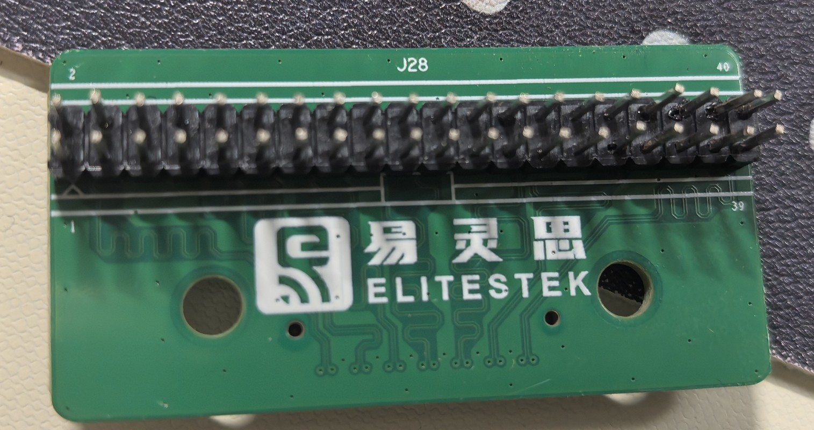
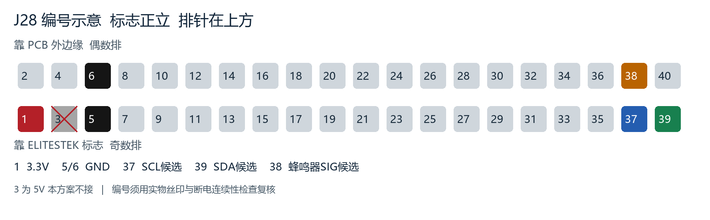

# Ti60F225 传感器与报警模块接线教程

版本：2026-10-25  
适用对象：Ti60F225 V4 系列主板、ELITESTEK EL_001_REV2.0 转接板、Waveshare MLX90640-D55、DFRobot SHT30/SEN0330、Seeed Buzzer v1.3。

本教程用于第一次上板前的硬件核对和接线准备。J7.37/B3、J7.39/C3、J7.38/B5 是根据现有主板资料整理出的候选分配，仍需 A/C 用当前顶层工程和最终约束文件确认。没有完成确认前，不要烧录正式工程，也不要把 5V 接到 FPGA 信号脚。

## 一、开始前的状态和器材

这是一份完整的接线准备与验收流程，状态为“图纸候选，尚未实测”。当前团队 C3 的 I2C/GPIO 仍无实物后端；仅接好线不会自动出现读数。接线前 A/C 必须确认候选引脚，提供有超时恢复的总线后端、蜂鸣器默认关闭配置以及与整机公共 APB 时间一致的毫秒时钟。仅有 CLINT 的独立诊断绑定不作为整机统一时间。

本教程没有改动主板 J2/J3 跳线，不包含 Flash 擦写和烧录操作。主板 Flash 的照片丝印与资料存在差异，确认实际器件与电源前不得照搬烧录器设置。

### 器材清单

- Ti60F225 主板。
- ELITESTEK MIPI and LVDS Expansion Daughter Card，实物丝印 `EL_001_REV2.0`。
- 主板 J7 对应的 QSE 连接器和转接板 J26；转接板的 2×20 排针为 J28。
- Waveshare `MLX90640-D55` 热成像模块，4 针 I2C 接口。
- DFRobot `SHT30 Digital Temperature & Humidity Sensor V1.0 / SEN0330`，接口为 `VCC/GND/SCL/SDA/INT/RST`。
- Seeed Buzzer v1.3，接口为 `GND/VCC/NC/SIG`。
- 与端子匹配的 2.54mm 杜邦线、绝缘的电源分线端子或面包板、万用表，以及厂家配套主板电源。主板输入电压按板卡电源标记/厂家说明核对，不能把 J28 的 3.3V 当作主板输入电压。
- SHT30 照片中六个孔尚未焊排针，需要焊好排针或使用可靠的焊接转接线。杜邦母头不能插在空孔里靠接触工作；不熟悉焊接时请同学协助，焊后检查相邻焊点短路。

## 二、接口关系

转接板原理图给出的关系是：`J26.n -> J28.n` 同号直通，转接板不做电平转换。因此信号路径为：

```text
Ti60F225 主板 J7  ->  转接板高密度口 J26  ->  转接板排针 J28  ->  传感器/蜂鸣器
```

本教程采用 3.3V 供电候选，两个 I2C 设备共用一组总线：

| 主板 J7 | 转接板 J26 | 转接板 J28 | 主板网络/FPGA 球位 | 候选用途 |
|---:|---:|---:|---|---|
| 1 | 1 | 1 | `VCC_3V3` | 传感器和蜂鸣器 3.3V 电源 |
| 5 或 6 | 5 或 6 | 5 或 6 | `GND` | 公共地 |
| 37 | 37 | 37 | `GPIOL_04` / B3，TL bank 3.3V | I2C `SCL` |
| 39 | 39 | 39 | `GPIOL_06` / C3，TL bank 3.3V | I2C `SDA` |
| 38 | 38 | 38 | `GPIOL_10` / B5，TL bank 3.3V | 蜂鸣器 `SIG` |

J7.3/J28.3 是资料定义的 5V 电源，本教程不使用。J7.32/C5、J7.34/A4、J7.40/A12 暂作备用，不接入本次传感器方案。其余 J7 引脚包括 1.8V/1.2V 的 MIPI/LVDS 网络，不能当作 3.3V GPIO 使用。

## 三、定位 J28 并核对方向

将转接板带有 ELITESTEK 标志的一面朝向自己，旋转至标志正立，J28 长排针位于图上方。照片中 1/2 在左端，39/40 在右端。靠标志一排是奇数 1、3、5……39，靠 PCB 外边缘一排是偶数 2、4、6……40。这个描述只适用于下图视角；换到背面或转动板子后，先重新寻找丝印 1/2，不能记“左边第几根”。





图中 37/39/38 分别为 SCL/SDA/SIG 候选，不是已经下发的 FPGA 配置。

### 断电检查

1. 关闭主板电源、USB、下载器和外部模块电源。不要带电插拔 J7/J26。
2. 检查主板 J7 的连接器定位缺口和转接板 J26 的定位方向。插接时两端应平行、完全贴合，不能斜插或用力压单边。
3. 确认转接板 J28 的编号方向。以 PCB 丝印的 `1` 和 `39` 为定位，不要根据排针上下方向猜测奇偶列。
4. 用万用表在断电状态下做连续性检查：J7.1 到 J28.1、J7.5/6 到 J28.5/6、J7.37 到 J28.37、J7.39 到 J28.39、J7.38 到 J28.38。若编号不通或相邻针短路，停止接线。
5. 先确认 A/C 当前工程没有把 B3、C3、B5 用作别的输出。厂家 GE 例程的 `.isf` 与 `.peri.xml` 存在引脚分配差异，不能直接复用旧约束文件。
6. 确认所有模块端的 `VCC`、`GND`、`SCL`、`SDA`、`SIG` 丝印，再插线。不要按线材颜色推断信号。

### 先测电源再接模块

断电检查通过后，保持所有模块和信号线未接，用厂家配套电源给主板上电。万用表置直流电压档，黑表笔固定在已确认的 J28.5/6 GND，红表笔接 J28.1，测得约 3.3V 并记录；测量时避免表笔桥接相邻针。如果测得约 5V、0V 或明显偏离标称值，停止并重新核对编号、R123 及版本。测完关闭主板和所有辅助电源，再接模块。通断/电阻档仅用于断电状态，不得在带电板上使用。

J28.1 需要向多个模块分线时，使用可靠的分线端子，每个端子只插适配数量的导线；所有 GND 共地。模块电流总和必须在板上 3.3V 余量之内；如果使用独立稳压电源，需要由 A/C 核对电平和供电时序，不能把它的 3.3V 输出与主板 J28.1 直接并联，也不能让信号线向断电板反向供电。

## 四、连接 SHT30 温湿度模块

SHT30 模块使用 I2C，推荐先单独接它调试。

| SHT30 端子 | 连接到 J28 | 说明 |
|---|---:|---|
| `VCC` | 1 | 3.3V 候选供电 |
| `GND` | 5 或 6 | 公共地 |
| `SCL` | 37 | 与 MLX90640 共用 I2C SCL |
| `SDA` | 39 | 与 MLX90640 共用 I2C SDA |
| `INT` | 不接 | 基础温湿度采样不需要 |
| `RST` | 不接 | 暂不分配，不能随意拉低 |

模块上的地址选择区域标注 `0x45` 和 `0x44`。上电后的软件顺序是先探测 7 位地址 `0x45`，无响应再探测 `0x44`，并用 SHT30 CRC 校验确认有效读数。模块板上的 10kΩ 上拉跟随 VCC，故本教程使用 3.3V 供电。

## 五、连接 MLX90640-D55 热成像模块

该模块为用户购买页标注的 `MLX90640-D55`，视场角 55°×35°，分辨率 32×24。模块带 I2C 接口和板载电平转换，但“模块支持 5V”不代表 FPGA 信号脚可以接 5V，所以仍使用 3.3V 候选供电。

| MLX90640 端子 | 连接到 J28 | 说明 |
|---|---:|---|
| `VCC` | 1 | 3.3V 候选供电 |
| `GND` | 5 或 6 | 公共地 |
| `SCL` | 37 | 与 SHT30 共用 SCL |
| `SDA` | 39 | 与 SHT30 共用 SDA |

模块默认 7 位地址按 `0x33` 处理，但仍需软件读取设备响应和 EEPROM 后确认。不要把 `0x33` 写成 8 位地址 `0x66`，也不要在没有读取 EEPROM 校准参数前发布温度结果。

## 六、连接有源蜂鸣器

Seeed Buzzer v1.3 板上有 Q1 驱动器件，接口丝印为 `GND/VCC/NC/SIG`。按以下方式连接：

| 蜂鸣器端子 | 连接到 J28 | 说明 |
|---|---:|---|
| `VCC` | 1 | 3.3V 候选供电；上电电流仍需核验 |
| `GND` | 5 或 6 | 公共地 |
| `SIG` | 38 | B5/GPIOL_10 候选报警输出 |
| `NC` | 不接 | 保持悬空 |

软件初始状态必须为关闭，FPGA 配置前也要有确定的静音电平；如模块本身没有可靠下拉，由 A/C 依据驱动电路补充外部下拉。先保持蜂鸣器未连接，确认 GPIO 和低电平，再断电接入。第一次测试只发送一次 100ms 左右的短高电平脉冲，确认极性后再接入持续报警策略。现有逻辑约定中 GPIO 通道 1 是蜂鸣器，实际后端负责把通道 1 映射到 B5，并根据实测极性决定 `active=1` 还是 `active=0`。

## 七、推荐上电和测试顺序

所有增删线和更换模块都在完全断电后进行。主板初始 FPGA 配置必须让传感器引脚处于输入/释放状态，让蜂鸣器关闭。每一步通过后再断电进入下一步。

### 第一步：只接转接板和万用表

不接任何传感器和蜂鸣器，确认 J7/J26/J28 的机械方向、3.3V 与 GND 没有短路。A/C 确认 B3/C3/B5 没有工程冲突后再继续。

### 第二步：只接 SHT30

A/C 提供真实 I2C 后端后才能开始；返回 ENOTSUP 表示后端未实现，不能当作器件坏了。先以 100kHz 作为带宽较低的连通性调试候选，不把此速率承诺为最终热图帧率。上电后先运行最小 I2C 后端，按 `0x45 -> 0x44` 探测。读取一组温度和湿度，检查两字节 CRC；连续采样至少 100 次，记录时间戳、地址、原始字节、CRC 结果和错误码。

### 第三步：只接 MLX90640-D55

先确认 0x33 响应，读取 EEPROM 及其中的序列信息，再由官方库完成参数提取和校准。采集两个不同子页，确认能组出 768 个像素；检查坏点位图、帧时间戳和错误标志。没有校准参数时，不能把原始 EEPROM 或原始帧直接显示成摄氏度。

### 第四步：同时接两个 I2C 设备

两个设备可以共用 SCL/SDA，因为地址不同。先分别确认 `0x45/0x44` 与 `0x33`，再检查总线 ACK、上拉波形和重复起始。任何一个设备拉死 SDA 时，停止采样并执行后端的 STOP/总线恢复流程。

### 第五步：最后接蜂鸣器

确认传感器数据有效后再接 `SIG`。确认实际模块确为高电平使能后，先验证低电平静音，再发一次短高电平，最后验证触发、保持、解除和重新布防。不要把蜂鸣器的 `NC` 接到 J28 的任何信号脚。

## 八、常见问题

| 现象 | 优先检查 |
|---|---|
| 两个 I2C 设备都无响应 | J28 奇偶列是否看反、J7/J26 是否插反、J28.1 是否真为 3.3V、SCL/SDA 是否接反 |
| SHT30 在 0x45 无响应 | 检查地址焊盘，再尝试 0x44；检查 VCC 上拉和 CRC，不要只看 ACK |
| MLX90640 有 ACK 但温度异常 | 检查是否读取 EEPROM、是否完成官方校准、两个子页是否不同、模式和配置是否一致、时间差是否合格 |
| 蜂鸣器一直响 | 先断电，移除 SIG；确认 GPIO 初始状态、极性和 Q1 驱动，不要长时间直接试输出 |
| 上电电流异常或 FPGA 复位 | 立即断电，检查 J28.3 是否误接、是否把 5V 送到模块信号、是否存在相邻针短路 |
| 插上网口例程后传感器失效 | 检查当前工程约束。旧 GE 例程的 `.isf` 与 `.peri.xml` 不一致，不能混用 |

## 九、摄像头和整机连接边界

SC431HAI 摄像头模组的 FPC 连接由 A 按当前工程采用的 J4 或 J5 进行确认。本次只给 B 的传感器与报警接线；不要因为两个插座外观相同就互换，不要把芯片手册中的 1.2V/1.8V/2.8V 直接接到模组输入端。断电后核对排线针数、金手指朝向、锁扣以及模组端编号。摄像头、传感器、网线和下载接口分别按厂家定义连接，不能把四针蜂鸣器线当作四针 I2C 线插。

## 十、软件侧首次运行门槛

- C3 应提供 TIME、I2C、GPIO 能力；单独 TIME=1 不能采样或报警。必须检查每次调用的返回值。I2C 逻辑总线 0、GPIO 通道 0/1 都不等于 FPGA 封装球位。
- SCL/SDA 用开漏或“拉低/高阻释放”的方式实现，读取真实线电平；超时非零、失败后 STOP/总线恢复。写寄存器后读取 MLX90640 时需要重复 START。
- SHT30 发单次测量命令后按驱动等待，读取 6 字节，核验两处 CRC。有效性、错误码和时间戳通过后才发布样本。
- MLX90640 先用本设备 EEPROM 提取校准，再换算不同子页；配置改变、超时、坏点或帧不完整时按 B 接口标志处理，不能沿用旧数据冒充新样本。当前上传的驱动仍需集成真实采集调度，接线教程不会代替这部分固件。
- 先手动测试 GPIO，随后接 C 的事件请求。现有报警输出策略是 250ms 开/750ms 关，持续上限由 C 的集成代码传入；不把该时序解释为跌倒判据。

## 十一、验收记录

每次测试至少记录：主板与子卡实物照片、主板/J28 编号方向、供电电压、I2C 7 位地址、采样时间戳、CRC/ACK 结果、MLX90640 EEPROM 和子页状态、蜂鸣器极性、工程约束文件哈希。只有真实板上数据通过后，才能把“候选接线”改成“已确认接线”。

本教程依据：主板原理图 PDF 第 3、8、11 页，设计说明 PDF 第 27–28 页，QSE 转排针原理图第 1 页，用户模块照片及购买页。相关资料：`B_厂家资料核对_20261025.md`、`B_实物核对_20261025.md`、`待核对接线表.csv`、`B_接入说明.md`。
